# Banco de motores a reacción

Simulador 3D interactivo de cuatro motores a reacción, hecho con Three.js y sin ningún paso de compilación: un **turbofan de alta derivación**, un **turborreactor con postquemador**, un **estatorreactor (ramjet)** y un **scramjet**. Cada uno tiene sus piezas móviles, su ciclo termodinámico simplificado y su dinámica de ejes en tiempo real, con el aire dibujado como estelas que entran por la toma, rodean las carcasas y se mezclan en el chorro.

<p align="center">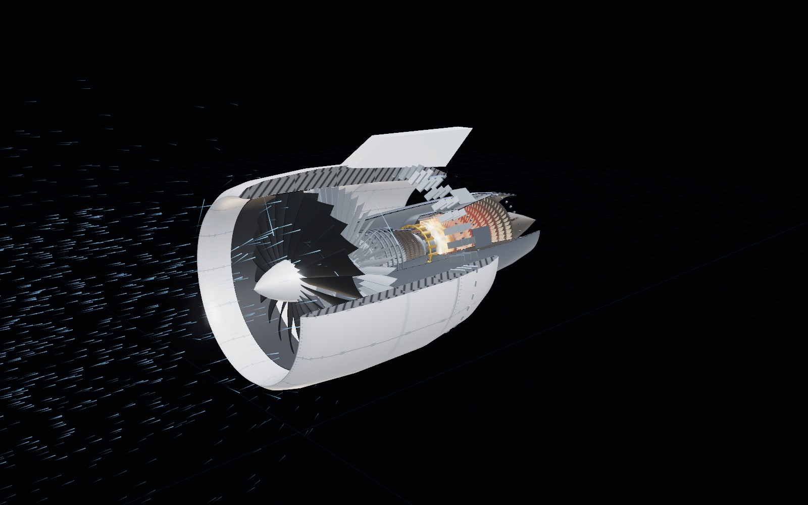</p>

**Demo en línea:** <https://cristianruben-dev.github.io/jet-engine-test-bench/> · Código: <https://github.com/cristianruben-dev/jet-engine-test-bench>

## Qué puedes hacer

- **Elegir motor** y verlo por dentro con tres cortes de carcasa (completo, un cuarto, media), tapas de sección y una descripción de cada pieza al pasar el ratón, con su temperatura de gas y de metal, presión y velocidad.
- **Pintarlo** con los materiales reales, o como mapa de temperatura (del gas o del metal refrigerado), de presión o de velocidad, calculados a partir del ciclo.
- **Mover los mandos**: acelerador, velocidad del aire (hasta M 10 en el scramjet), altitud (atmósfera ISA hasta 32 km), viento cruzado, corte de combustible, limitador FADEC e inversor de empuje.
- **Provocar transitorios reales**: arranque con arrancador neumático, apagado y molinete, bombeo del compresor al acelerar sin limitador, apagado de llama por mezcla pobre en altura, *unstart* del scramjet y un aterrizaje con el inversor desplegado.
- **Leer los instrumentos**: régimen, empuje, caudal, consumo, EGT, rendimientos, temperatura por componente, un registro de los últimos 60 s, el mapa del compresor con su línea de bombeo, el diagrama T‑s en vivo y la comparación de los cuatro motores frente al Mach.
- **Seguir la guía** estación por estación, lanzar escenarios preparados, activar las etiquetas de estación sobre el modelo, escuchar el motor (sonido sintetizado) y compartir cualquier estado copiando la dirección: todo va en el *hash* de la URL.

## Galería

<p align="center">
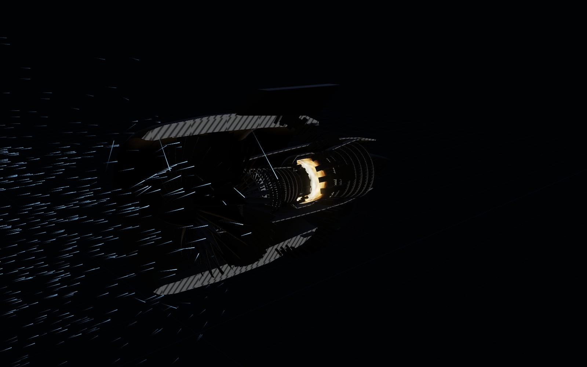 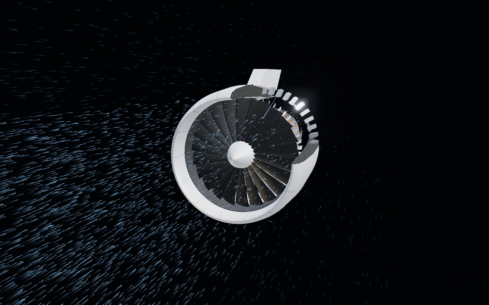
</p>
<p align="center"><sub>Vista térmica (temperatura del metal refrigerado) · Succión del fan a gas a fondo con el avión parado: el aire entra desde todas partes, incluso desde detrás del labio</sub></p>

<p align="center">
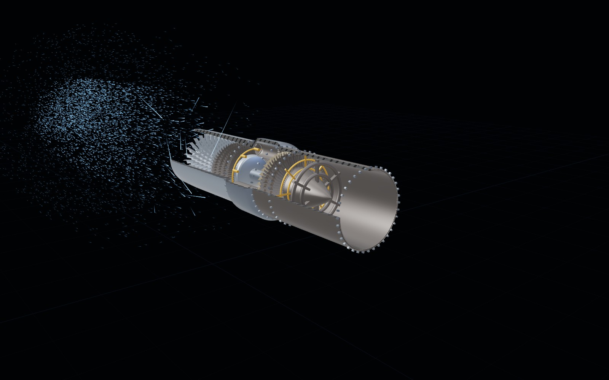 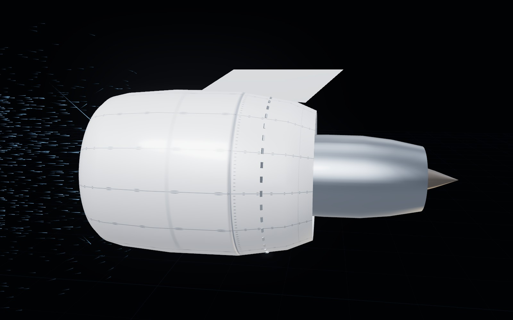
</p>
<p align="center"><sub>Turborreactor con el postquemador encendido y la tobera de pétalos abierta · Inversor de empuje: el manguito retrocede y el aire del fan sale hacia delante por las cascadas</sub></p>

<p align="center">
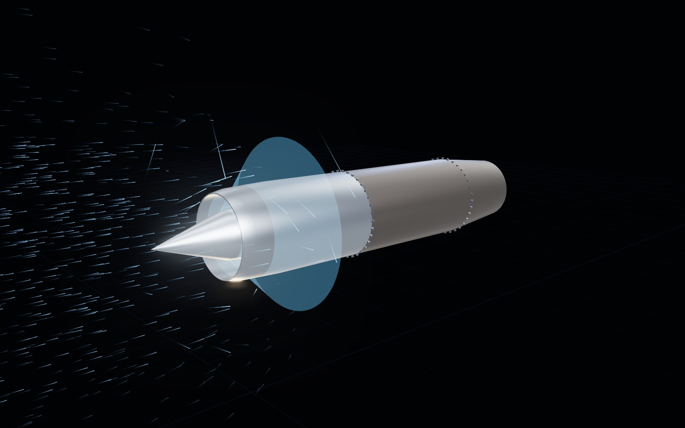 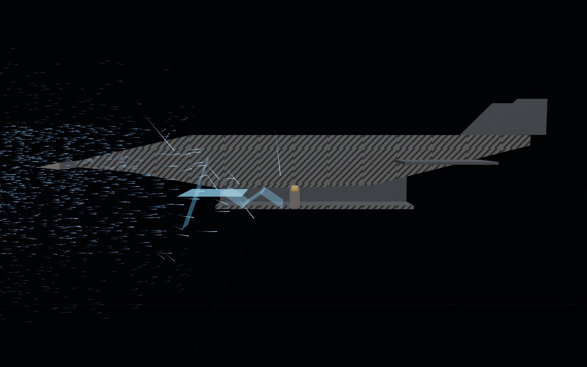
</p>
<p align="center"><sub>Estatorreactor a M 3: choque cónico sobre el cono de entrada · Scramjet a M 7: el aire mantiene su altura hasta cruzar el choque de la proa y arde todavía supersónico</sub></p>

<p align="center">
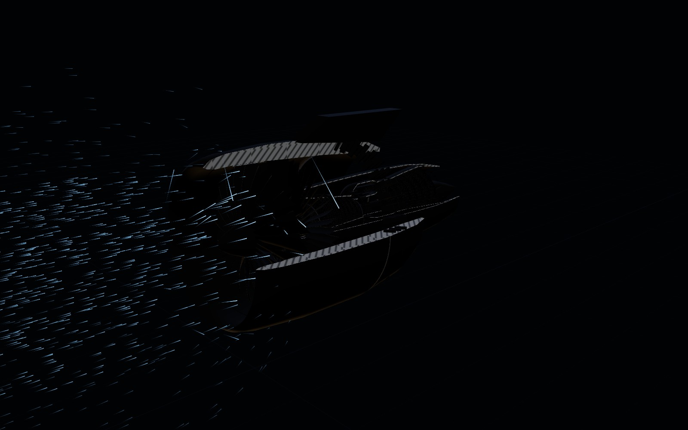 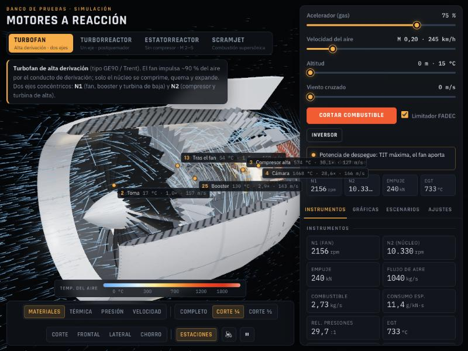
</p>
<p align="center"><sub>Vista de velocidad en crucero a M 0,85 y 11 km · Etiquetas de estación con temperatura, presión y velocidad en vivo</sub></p>

<p align="center">
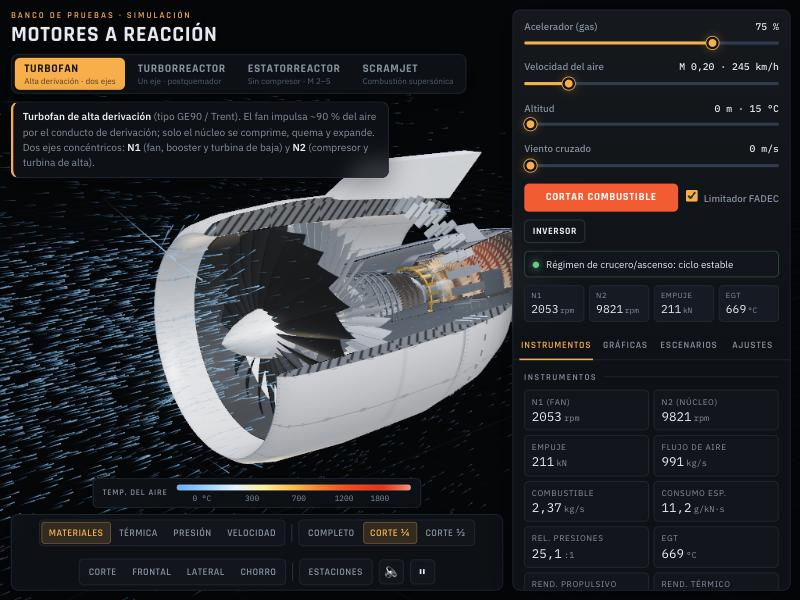 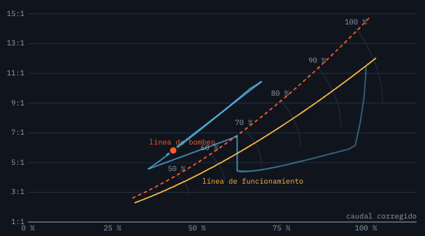
</p>
<p align="center"><sub>La interfaz: escena, barra de vistas y panel de instrumentos · Mapa del compresor durante un acelerón sin limitador: el punto cruza la línea de bombeo</sub></p>

<p align="center">
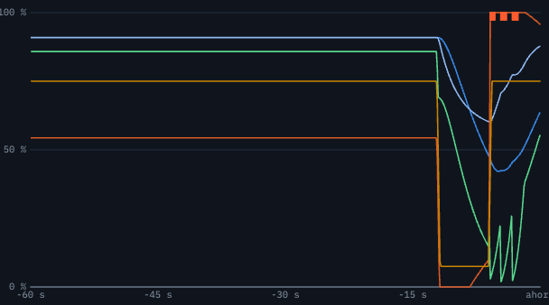 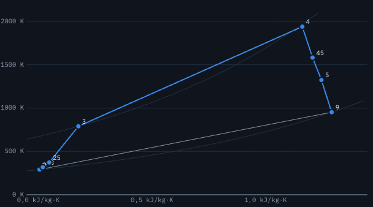
</p>
<p align="center"><sub>Registro de los últimos 60 s con las marcas de bombeo · Diagrama T‑s del ciclo en vivo</sub></p>

## Cómo ejecutarlo

Los archivos deben servirse por HTTP, porque los módulos ES no cargan desde `file://`:

```bash
python3 -m http.server 8765 --bind 127.0.0.1
```

y abre <http://localhost:8765/>. Three.js y sus complementos se cargan desde jsDelivr, y las fuentes desde Google Fonts; no hay dependencias que instalar.

El modelo (atmósfera, ciclos, dinámica de ejes y mapa del compresor) no depende del DOM y se prueba en Node:

```bash
node --test
```

## Interfaz

Escena 3D a pantalla completa. Arriba a la izquierda, el título, las pestañas de motor y la descripción (que la tarjeta de la guía sustituye mientras recorres el motor). Abajo en el centro, flotando sobre la escena, la escala de color de la vista activa y la barra de vistas: pintado, gas o metal, corte, cámaras, etiquetas de estación, sonido y pausa. A la derecha, el panel de instrumentos con una cabecera fija (acelerador, velocidad, altitud, viento cruzado, botón de arranque o corte, limitador FADEC, inversor en el turbofan, línea de estado, avisos y cuatro instrumentos clave) y un cuerpo con pestañas: Instrumentos, Gráficas, Escenarios y Ajustes. En el móvil el panel se convierte en una hoja inferior y la escena queda encima.

Atajos: `Espacio` pausa, `1`–`4` cambian el pintado, `C` alterna el corte, `E` muestra las etiquetas de estación, `S` activa el sonido, `Esc` cierra la guía y `←`/`→` se mueven entre pestañas.

## Estructura

```
index.html               Solo marcado (sin estilos ni lógica)
css/styles.css           Hoja de estilos: variables, superposiciones de la escena, barra, panel, gráficas, guía, hoja móvil
js/main.js               Punto de entrada y bucle de simulación (dinámica → ciclo → pintado → flujo → registro)
js/ui.js                 Pestañas, mandos, arranque y corte, barra, escala, panel, gráficas, escenarios, guía, tooltip, etiquetas, hash de la URL
js/state.js              Estado global, constantes de escala temporal y presupuestos de partículas
js/fallback.js           Aviso cuando el CDN no responde
js/core/utils.js         Ayudas numéricas, formato y paletas de cada vista
js/core/atmosphere.js    Atmósfera ISA (0–32 km)
js/core/scene.js         Renderer, cámara, luces, entorno, bloom y vuelos de cámara
js/core/cuts.js          Planos de recorte del corte
js/core/caps.js          Tapas de sección por stencil de las carcasas cortadas
js/core/materials.js     Materiales base
js/core/textures.js      Texturas procedurales: paneles, orificios de dilución, refrigeración, rayado
js/core/geometry.js      Cuerpos de revolución, carcasas, álabes instanciados (con UV), perfiles
js/core/flame.js         Shader de llama (ruido simplex) y tubos de llama
js/core/shocks.js        Ondas de choque y la relación θ-β-M
js/core/engine.js        Clase Engine: piezas con estación y refrigeración, ejes, estátores variables, corrientes, tapas
js/core/thermo.js        Ciclo termodinámico de cada motor: estaciones (T, P, V), caudal de combustible, rendimientos
js/core/dynamics.js      Dinámica de ejes, arranque y parada, limitador FADEC, bombeo, apagado, unstart, inversor, mapa del compresor
js/core/flow.js          Estelas de aire en una sola llamada instanciada: sumidero de la toma, guiado por los cuerpos, corrientes, giro, mezcla
js/core/paint.js         Color de cada pieza según la vista (resplandor, temperatura, presión, velocidad) y de las tapas
js/core/charts.js        Comparación de los cuatro motores frente al Mach, diagrama T‑s, registro de 60 s y mapa del compresor
js/core/sound.js         Sonido sintetizado: tono del fan, silbido, rumor, siseo, postquemador, arrancador, golpe de bombeo
js/engines/turbofan.js   Geometría del turbofan, VSV, válvulas de sangrado, pilón, inversor, corrientes, guía
js/engines/turbojet.js   Turborreactor con IGV variables, postquemador y tobera de pétalos
js/engines/ramjet.js     Estatorreactor con cono de entrada
js/engines/scramjet.js   Scramjet con rampas, choques oblicuos y estabilizadores
js/engines/index.js      Catálogo de motores (constructor, termodinámica, rangos, textos, escenarios)
test/model.test.mjs      Pruebas en Node de la atmósfera, los ciclos, la dinámica de ejes y el mapa del compresor
docs/img/                Capturas de este README
```

## Notas del modelo

- Las temperaturas de estación son temperaturas totales del gas; la vista térmica puede mostrar en su lugar la del metal de las piezas refrigeradas, `T_metal = T_gas − cool·(T_gas − T_refrigerante)`, con el refrigerante a la temperatura de salida del compresor.
- El caudal de combustible sale del calor añadido en cada estación (`ΔT = f·PCI·η/cp`); de él se derivan el consumo específico y los rendimientos propulsivo y térmico.
- El flujo no es un CFD. Fuera del motor cada partícula lleva la corriente libre más el sumidero del tubo de corriente capturado, cuya intensidad es la velocidad en la cara de entrada menos la de vuelo (así un motor en molinete o con poco gas en vuelo derrama, y un compresor en bombeo sopla aire por la toma); cerca de un cuerpo su velocidad radial sigue la pendiente del perfil, leída un poco por delante, y tras la tobera el chorro libre prolonga el cuerpo, de modo que el aire exterior se desliza por su capa de corte y es arrastrado por ella. Dentro, las partículas siguen corrientes programadas (radio, velocidad y temperatura por estación) con el giro de los rotores, una deriva lenta en la llama y en el chorro libre, y un factor de paso `q` que se anula con el motor parado y sin viento.
- Las estelas son cuadriláteros en espacio de pantalla (ancho constante en píxeles, bordes suaves, cabeza redonda) dibujados con alfa premultiplicado; con un corte, la mayoría de las partículas nuevas nacen en el sector abierto para que se vea el flujo interno. El aire exterior se atenúa con la altitud. Tras el cono del estatorreactor el aire gira dentro del choque cónico; el aire capturado por el scramjet mantiene su altura hasta que lo alcanza el choque de la proa. El viento cruzado añade una corriente lateral y, en tierra con una toma parada que succiona, un filamento de vórtice sube del suelo al labio inferior. Por encima de M 8 las temperaturas del scramjet ignoran la disociación.
- El inversor del turbofan es un manguito deslizante con cascadas y diez compuertas: la corriente de derivación se desvía a una corriente invertida que sale hacia delante por las cascadas y se libera como aire exterior (que la toma puede volver a tragar a baja velocidad); el ciclo cuenta entonces la cantidad de movimiento del bypass hacia delante y el empuje se vuelve negativo.
- El mapa del compresor es esquemático: la línea de funcionamiento es el régimen estable, la línea de bombeo queda un 10–22 % por encima, y el punto sube con el exceso de combustible sobre el régimen estable (la misma magnitud que limita el FADEC), así que un acelerón sin limitador cruza la línea justo cuando la dinámica dispara el bombeo.
- El sonido es sintetizado: un diente de sierra a la mitad de la frecuencia de paso de álabes del fan, un silbido senoidal del eje de alta, ruido filtrado para la combustión y el chorro, un rugido en banda para el postquemador, un barrido triangular para el arrancador y una ráfaga de ruido en el bombeo o el *unstart*.
- La calidad baja sola un nivel de partículas cuando un cuadro cuesta más de 22 ms de CPU durante tres segundos.

## Depuración

La página expone `window.__sim` (cámara, controles, estado, `dyn`, `engine`, `R`, `loadEngine`, `flyTo`, `fps`, `renderer`) para manejar la simulación desde la consola del navegador.
